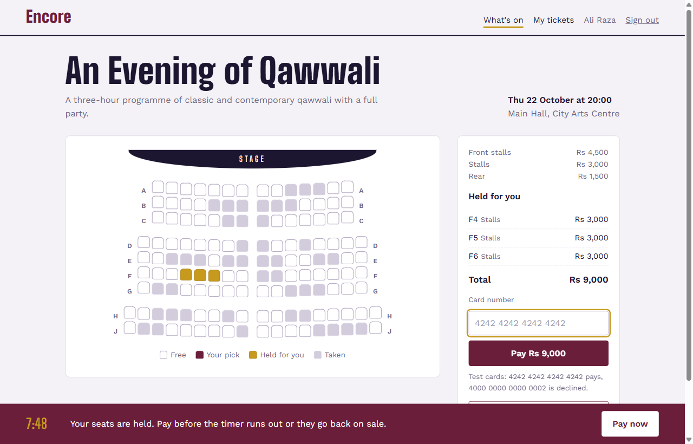
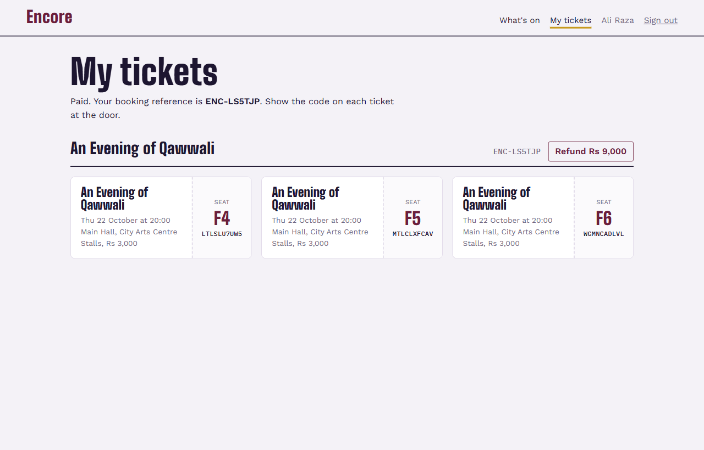

# Encore

**An event seat-booking backend that never sells a seat twice: expiring holds, all-or-nothing seat locking, idempotent checkout.**

[](https://github.com/qasimrazamalik-coder/encore-seat-booking-api/actions/workflows/ci.yml)


[](LICENSE)

<p align="center">
  
  
</p>

A booking backend for small venues: customers pick seats on a seat map, the seats are **held** for a few minutes while they pay, and payment turns the hold into an **order** with one **ticket** per seat. Organizers publish events, scan tickets at the door, refund, cancel and read sales reports.

The interesting part is what happens when many people want the same seat at the same moment. Encore guarantees, and its tests prove under real concurrency, that:

- a seat is never sold twice, and never sits in two holds at once;
- a request for several seats gets all of them or none of them;
- a double-clicked pay button, a network retry or a second browser tab charges once and creates one order;
- held seats come back on sale the moment the hold runs out, without waiting for any background job.

Node.js 20, Express 5, PostgreSQL 16, plain SQL (no ORM), zod, JWT. The frontend is a small plain-JavaScript page served by the same app.

## Highlights

- **30 people grab the same seat at once, exactly one gets it**: proven by a race test against real PostgreSQL
- **All-or-nothing holds**: ask for four seats and you get four or none, never a partial hold
- **No deadlocks**: seats are always locked in id order (40 shuffled overlapping requests in the tests)
- **Idempotent checkout**: a double-clicked Pay button or a network retry charges once (`Idempotency-Key`)
- **Expiring holds** freed instantly on read and tidied by a `SKIP LOCKED` background sweeper
- **"The snapshot trap"**: a real READ COMMITTED double-booking bug, found by the race tests and explained in this README
- **Refunds, door check-in and event cancellation**, all transactional, plus a sales report

## Run it

You do not need to install PostgreSQL; a real Postgres server ships as a dev dependency.

```bash
npm install
npm run db        # terminal 1: starts PostgreSQL on port 5543 and keeps running
npm run setup     # terminal 2: creates the tables and loads demo data
npm start         # http://localhost:3003   API docs at /api/docs
```

Or with Docker: `docker compose up --build`, then `docker compose exec api node scripts/seed.js`.

**Demo accounts** (password `password123`): `organizer@encore.test` (door and sales), `zainab@encore.test`, `ali@encore.test` (customers).
**Test cards:** `4242 4242 4242 4242` pays, `4000 0000 0000 0002` is declined. Any other number that passes the Luhn check pays.

## Tests

```bash
npm test
```

Starts a throwaway PostgreSQL on a random port, migrates it, runs 26 tests against the real database and removes it. Nothing is mocked: the race tests fire genuinely parallel HTTP requests that compete for real row locks.

| Test | What it proves |
|---|---|
| RACE: thirty people grab the same seat at once | exactly one 201, twenty-nine `SEATS_UNAVAILABLE` |
| RACE: overlapping requests are all-or-nothing | no request ever ends up with part of what it asked for |
| RACE: forty shuffled overlapping requests | no deadlocks, and no seat in two holds |
| RACE: double-clicked pay button (same key, five at once) | one order, one charge, five identical answers |
| RACE: two tabs, different keys, same hold | one order; the other tab is told the hold is already paid |
| the database itself refuses a second valid ticket | the schema blocks a double sale even if the code were wrong |
| an expired hold frees its seats immediately | lazy expiry: no waiting for the sweeper |
| refunds close 24 hours before the show | business rule, with the cutoff configurable |
| door check-in once only | second scan is refused with when it was first scanned |
| cancelling an event | every order refunded and every hold dropped, in one transaction |

## How it works

### Seat lifecycle

```
available ──hold──▶ held ──pay──▶ sold
    ▲                 │              │
    └── expire/release┘              │
    └──────────────── refund ────────┘
```

`seats.status` and `seats.hold_id` move together, and a `CHECK ((status = 'held') = (hold_id IS NOT NULL))` constraint means they can never disagree.

### Holding seats (`POST /api/holds`)

One transaction:

0. Lock the event `FOR SHARE` and check it is on sale (a cancel waits for in-flight holds; see Paying).
1. Lock the requested seat rows with `SELECT … FOR UPDATE`, **ordered by id**. Every request locks in the same order, so two requests that overlap can make each other wait but can never deadlock.
2. Read the holds those seats point at, in a **separate** statement (see the snapshot trap, below).
3. A seat is free if it is `available`, or if it is `held` by a hold that has already expired. If any requested seat is not free, roll back and return `409 SEATS_UNAVAILABLE` with the seat ids, so the page can grey them out. Nothing is partly held.
4. Release the customer's previous hold for this event (picking again replaces your selection), create the new hold, and point the seats at it.

The per-person limit (`max_per_order`) counts seats in the new hold plus tickets already bought for the event.

### The snapshot trap

The first version locked seats and read their holds in one query:

```sql
SELECT s.*, h.expires_at FROM seats s LEFT JOIN holds h ON h.id = s.hold_id
 WHERE s.id = ANY($1) FOR UPDATE OF s
```

Under PostgreSQL's default READ COMMITTED isolation it double-booked seats in the race tests. When a transaction waits for a row lock and then gets it, PostgreSQL re-reads **the locked row** (the seat) at its latest version, but the joined row (the hold) is still the one from the statement's original snapshot. So request B could see the seat now pointing at request A's brand-new hold, fail to find that hold in its old snapshot, treat the seat as held by nothing, and take it.

The fix is to lock first and read afterwards: lock the seats in one statement, then read their holds in a **new** statement, which takes a fresh snapshot that includes everything committed while we waited. This is the kind of bug that only a real concurrent test finds; a test that runs requests one after another passes either way.

### Paying (`POST /api/orders`)

Requires an `Idempotency-Key` header. One transaction:

1. Lock the event `FOR SHARE`. This lets many checkouts run together but makes a concurrent *cancel* (which locks the event `FOR UPDATE`) wait until they finish, and stops new checkouts once the event is cancelled.
2. Lock the hold `FOR UPDATE`. It must be active, unexpired and yours.
3. Lock its seats `FOR UPDATE`, ordered by id.
4. Charge the card (a fake gateway with the test cards above).
5. Create the order and one ticket per seat, mark the seats sold and the hold converted.

Lock order is always event, then hold, then seats, everywhere in the code.

Two safety nets sit in the schema: `orders.hold_id` is `UNIQUE` (one order per hold, ever), and a partial unique index allows only one valid ticket per seat:

```sql
CREATE UNIQUE INDEX tickets_one_valid_per_seat ON tickets (seat_id) WHERE valid;
```

A refund sets `valid = false`, which frees the seat to be sold again without deleting history.

### Idempotency

`middleware/idempotency.js` wraps the checkout handler:

1. `INSERT` the key into `idempotency_keys (user_id, key, request_hash)` with `ON CONFLICT DO NOTHING`, then `SELECT … FOR UPDATE` it. A second request with the same key waits here until the first one finishes.
2. If a response is already stored for the key, return it again with `Idempotent-Replayed: true`. If the same key comes with a different body, return `422`: a key belongs to one request.
3. Otherwise run the handler inside a `SAVEPOINT`. A 2xx or 4xx outcome is stored with the key (a declined card stays declined on retry). A 5xx rolls back to the savepoint and is not stored, so a retry can succeed.

The page creates one key per pay attempt, so a double click reuses it.

### Expiry

A hold has `expires_at`. Two mechanisms work together:

- **Lazy:** every read and every hold request treats a seat held by an expired hold as free. Customers never wait for a background job.
- **Sweeper:** every 30 seconds (`HOLD_SWEEP_SECONDS`) the server marks expired holds as `expired` and frees their seats, using `FOR UPDATE SKIP LOCKED` so it never blocks a customer and two server instances never fight over the same hold.

Lazy expiry only *reads*; it never writes to a stale hold. An earlier version tidied stale holds up during the hold request, which could deadlock against the sweeper, which locks in the opposite direction.

### Errors

Every error has the same shape:

```json
{ "error": { "code": "SEATS_UNAVAILABLE", "message": "Someone else got some of those seats first. Pick again.", "details": { "seatIds": [12, 13] } } }
```

PostgreSQL errors are mapped centrally: a unique violation on `tickets_one_valid_per_seat` becomes `409 SEAT_ALREADY_SOLD`, a deadlock (`40P01`) becomes `503 RETRY`.

## API summary

Full reference with request and response schemas at `/api/docs` (OpenAPI 3, `docs/openapi.yaml`).

| Method | Path | Who | |
|---|---|---|---|
| POST | /api/auth/register, /api/auth/login | anyone | register always makes a customer |
| GET | /api/events | anyone | on sale, plus your own drafts |
| GET | /api/events/:id | anyone | seat map: `available`, `taken` or `yours` per seat |
| POST | /api/events | organizer | creates the event and every seat from a tier layout |
| POST | /api/events/:id/publish, /cancel | organizer | cancel refunds everything |
| POST | /api/events/:id/check-in | organizer | door scan |
| GET | /api/events/:id/report | organizer | revenue, sell-through per tier, daily sales |
| POST | /api/holds | customer | hold seats |
| DELETE | /api/holds/:id | customer | let them go |
| POST | /api/orders | customer | pay; needs `Idempotency-Key` |
| GET | /api/orders | customer | your tickets |
| POST | /api/orders/:ref/refund | customer or organizer | up to 24 hours before the show |

## Project layout

```
db/migrations/001_schema.sql   tables, constraints and indexes
src/modules/holds/             hold, release, expiry sweeper
src/modules/orders/            checkout, refunds, order views
src/modules/events/            events, seat map, door, reports
src/middleware/idempotency.js  replay-safe checkout
src/payments.js                fake card gateway
tests/                         API and race tests (node:test + supertest)
public/                        the booking page
```

## Configuration

See `.env.example`. `PORT`, `DATABASE_URL`, `JWT_SECRET` (required in production), `JWT_EXPIRES_IN`, `REFUND_CUTOFF_HOURS`, `HOLD_SWEEP_SECONDS`.

## Contributing

Issues and pull requests are welcome. Every push and pull request runs the full test suite against PostgreSQL 16 on Node 20 and 22, checks runtime dependencies with `npm audit`, and builds the Docker image. `main` is protected: changes go through a pull request with a green build.

## Security

Please report vulnerabilities privately; see [SECURITY.md](SECURITY.md). The demo accounts and development secrets are for local use only.

## License

[MIT](LICENSE) © 2026 Qasim Raza Malik
